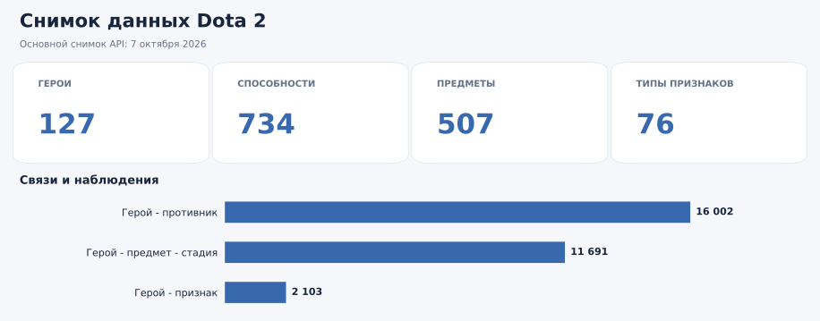
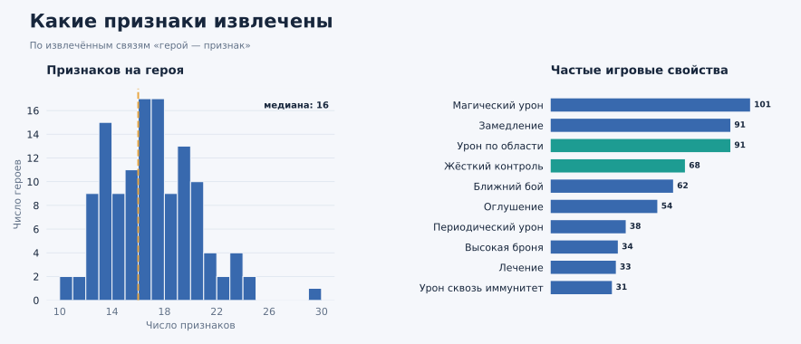
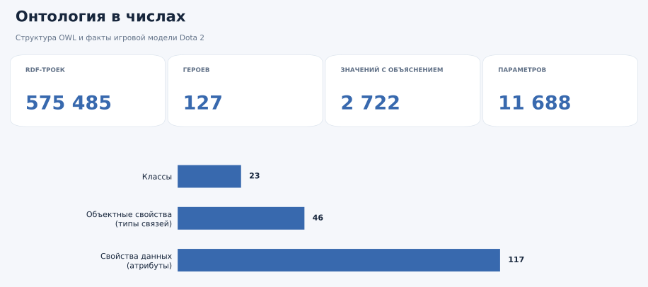
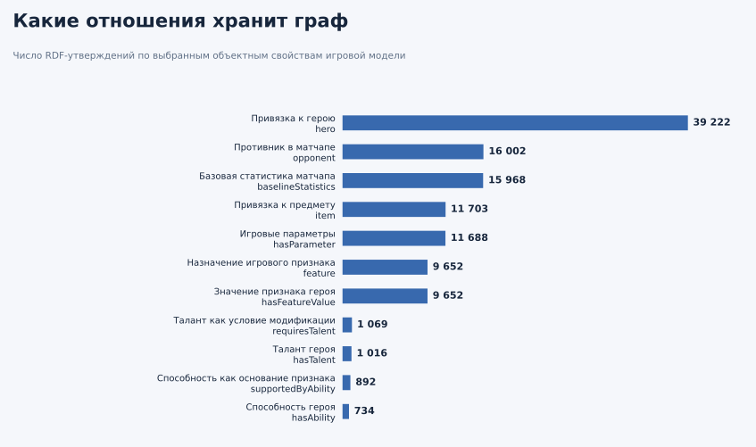

# Dota 2: граф знаний о контрпиках

Снимок игровых данных для графа знаний о контрпиках. Основные источники: [Valve](https://www.dota2.com/datafeed/herolist?language=english) и [OpenDota](https://api.opendota.com/api/heroes); ответы API получены **7 октября 2026 года**.



## Датасет

| Таблица | Объём | Содержание |
| --- | ---: | --- |
| [`heroes.parquet`](data/final/heroes.parquet) | **127** | Герои и их характеристики |
| [`abilities.parquet`](data/final/abilities.parquet) | **734** | Способности с привязкой к героям |
| [`items.parquet`](data/final/items.parquet) | **507** | Предметы и их свойства |
| [`hero_features.parquet`](data/final/hero_features.parquet) | **2 104** | Связи "герой - признак", **76** уникальных признаков |
| [`hero_feature_matrix.parquet`](data/final/hero_feature_matrix.parquet) | **127 x 76** | Значения признаков для каждого героя |
| [`matchups.parquet`](data/final/matchups.parquet) | **16 002** | Направленные противостояния героев |
| [`hero_items.parquet`](data/final/hero_items.parquet) | **11 691** | Связи "герой - предмет - стадия игры" |
| [`hero_meta.parquet`](data/final/hero_meta.parquet) | **127** | Общая статистика героев и показатели по рейтингам |
| [`hero_roles.parquet`](data/hero_roles.parquet) | **127** | Основная позиция каждого героя и дополнительная у 99 героев |
| [`mechanic_catalog.parquet`](data/mechanic_catalog.parquet) | **178** | Словарь механик эффектов и обобщений для правил |
| [`gameplay_mechanics.parquet`](data/gameplay_mechanics.parquet) | **2 247** | Факты о 673 способностях и 228 предметах; представлены все 127 героев |
| [`counter_rules.parquet`](data/counter_rules.parquet) | **104** | 80 правил для героев и 24 дополнительных правила для покупок |

## Признаки героев




**76 признаков** описывают героя в целом. **159 типов механик эффектов** уточняют действия конкретных способностей и предметов: получателя эффекта, условия применения и игровое объяснение. Число фактов отличается от числа типов: одна механика встречается у разных героев и предметов.


## Противостояния и предметы


## Онтология

[Игровая модель](ontology/game.ttl) | [Схема OWL](ontology/schema.ttl) | [Проверка](ontology/validation.json)

Значения признаков связаны с объяснениями и способностями, таланты - с модификаторами параметров. У героев хранятся оценки девяти игровых ролей и популярные позиции: `mostPopularPosition` и необязательное `secondMostPopularPosition`, целые числа от 1 до 5. У 28 героев с основной позицией 1 второе свойство отсутствует. В онтологии используется общая статистика; детализация по рейтингам сохранена в датасете.



| Структура | Количество |
| --- | ---: |
| RDF-тройки | **599 625** |
| Классы | **23** |
| Объектные свойства | **47** |
| Свойства данных | **125** |
| Значения признаков (герои x признаки) | **9 652** |
| Известные значения с объяснениями | **2 104** |
| Оценки ролей (свойства героев) | **1 143** |
| Популярные позиции (127 основных и 99 дополнительных) | **226** |
| Игровые параметры | **11 688** |
| Таланты героев | **1 016** |
| Связи модификаторов с талантами | **1 069** |
| Значения параметров | **21 956** |
| Модификаторы параметров | **1 365** |
| Пояснения механик и аспектов | **1 173** |
| Эффекты способностей и предметов | **2 852** |
| Механики эффектов и правил | **183** |
| Условные правила противодействия и компенсации | **117** |
| Условия взаимодействий | **697** |
| Подсказки покупки по роли и стадии | **12** |

Механики связаны со способностью или предметом через `hasEffect` и `effectMechanic`. Получатель хранится в `effectTarget`, условия - в `requiresCondition`: например, наличие Shard/Scepter, ночь, нужная стойка или направление удара. Новая разметка использует существующие классы. Общий словарь онтологии содержит 183 механики: 159 типов эффектов, 19 обобщений для правил и 5 сохраненных понятий. Из 117 правил 104 имеют веса: 80 общих правил и 24 дополнительных для покупок. Остальные сохраняют прежние взаимодействия и компенсацию уязвимостей.

`isObserved` отличает известное значение, включая ноль, от заполнителя матрицы. Урон, длительности эффектов, время поддержания и расход ресурсов связаны с именованными параметрами способностей и предметов. Отдельные эффекты и условия сохраняются раздельно; общие нулевые поля API не подменяют известные значения.





## Компетентностные вопросы

Компетентностные вопросы определяют задачи, которые должен решать граф знаний.

1. Какие герои могут противодействовать выбранному противнику благодаря своим способностям и игровым признакам?
2. Какие конкретные способности и механики объясняют преимущество одного героя против другого?
3. При каких условиях работает предложенное противодействие и какие ограничения оно имеет?
4. Какие способности и предметы позволяют прерывать поддерживаемые способности противника?
5. Какие герои и предметы позволяют противодействовать иллюзиям и призванным существам?
6. Какие способности и предметы позволяют обнаруживать невидимых противников?
7. Какие отрицательные эффекты противника можно снять и какие средства развеивания для этого необходимы?
8. Какие способности противника действуют сквозь невосприимчивость к эффектам?
9. Какие предметы подходят выбранному герою для противодействия конкретному противнику и почему?
10. Какие уязвимости выбранного героя можно компенсировать предметами?
11. Как наличие определённого предмета у противника влияет на эффективность контрпика?
12. Как таланты, аспекты, Aghanim’s Scepter и Aghanim’s Shard изменяют взаимодействие героев?

## Задать вопрос графу

```powershell
# CQ01 — подбор героев против противника
py -m dota_kg ask "Кто контрит Фантом Лансера на миде?"
# CQ02 — объяснение противодействия двух героев
py -m dota_kg ask "Почему Lion контрит Crystal Maiden?"
# CQ03 — условия применения и ограничения способности
py -m dota_kg ask "При каких условиях работает Shackleshot?"
# CQ04 — средства прерывания поддерживаемой способности
py -m dota_kg ask "Чем прервать Freezing Field?"
# CQ05 — противодействие иллюзиям и призванным существам
py -m dota_kg ask "Что помогает против иллюзий ПЛ?"
# CQ06 — обнаружение невидимых противников
py -m dota_kg ask "Чем обнаруживать невидимых противников?"
# CQ07 — снятие отрицательных эффектов
py -m dota_kg ask "Какие эффекты Lion можно снять развеиванием?"
# CQ08 — способности, проходящие сквозь невосприимчивость
py -m dota_kg ask "Какие способности Beastmaster проходят сквозь BKB?"
# CQ09 — предметы своему герою против выбранного противника
py -m dota_kg ask "Что купить Anti-Mage на керри против ПЛ в середине игры?"
# CQ10 — предметы для компенсации собственных уязвимостей
py -m dota_kg ask "Какие уязвимости Lion компенсировать предметами в начале игры?"
# CQ11 — влияние предмета противника на противодействие
py -m dota_kg ask "Как Lion контрит Crystal Maiden, если у противника активный BKB?"
# CQ12 — изменения от улучшений
py -m dota_kg ask "Что Shard меняет у Morphling?"
```

Текст разбирается в одну из 12 задач и только явно названные параметры. Для каждой
задачи есть один обработчик RDFLib; герои, способности, механики, предметы,
основания и условия ответа выбираются по графу

Ранжирование учитывает силу контрмеханик, независимые способности и ответные угрозы противника. Повторы одной способности не умножают балл; статистика пары дает только небольшую поправку. Веса находятся в датасете и RDF, расчет общий для всех героев. Предметы и улучшения учитываются при явном указании их наличия. При выборе покупки дополнительно учитываются статистика сборок самого героя, его позиция и тип атаки, стадия покупки и уже имеющиеся механики; повторяющиеся решения не заполняют список. Это оценка общего противодействия, а не прогноз исхода линии.

Рекомендации используют основную и, при наличии, дополнительную позицию героя из графа: **1 - керри, 2 - мид, 3 - офлейн, 4 - поддержка, 5 - полная поддержка**. Герои с основной позицией 1 рекомендуются только на керри.
Без указания позиции возвращаются варианты для каждой из пяти позиций, с позицией - только для нее.
Поддерживаются английские имена и распространённые русские клички

Проверить все вопросы и тесты:

```powershell
.\.venv\Scripts\python.exe scripts/check_competency_queries.py
.\.venv\Scripts\python.exe -m unittest discover -s tests
```

## Насыщение графа

Обучили ComplEx на связях героев, способностей и механик с учётом весов правил. Модель оценивает, у кого винрейт против выбранного соперника может оказаться выше собственного среднего. Для пар без указанного источника и рассчитанного отклонения винрейта сохранили связи с положительным баллом модели как гипотезы.

`predict` читает эти гипотезы из RDF. `rank` подбирает контрпики по способностям и весам правил. Обе команды принимают любого героя из графа по английскому имени или известному прозвищу. Например, `ВР` и `врка` означают Windranger. `--limit` задаёт число строк в ответе.

```powershell
dota_kg rank ВР --limit 3
```

По механикам в топ вышли Doom (`Doom`), Silencer (`Last Word`) и Drow Ranger (`Gust`).

```powershell
dota_kg predict Bloodseeker --limit 2
```

Модель предполагает, что у Elder Titan и Meepo винрейт против Bloodseeker может быть выше их обычного. Если для героя нет сохранённых гипотез, `predict` сообщает об этом.
