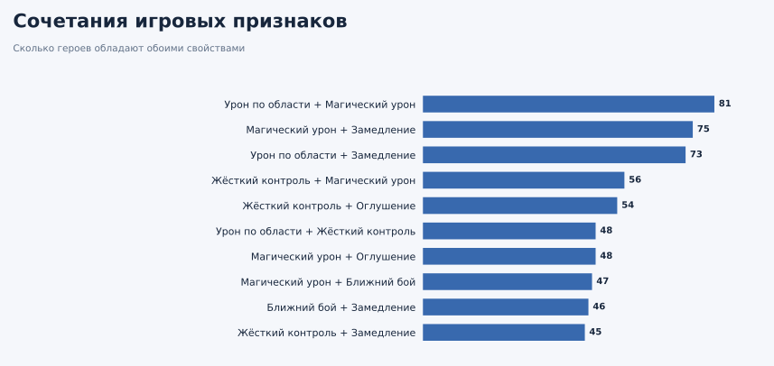
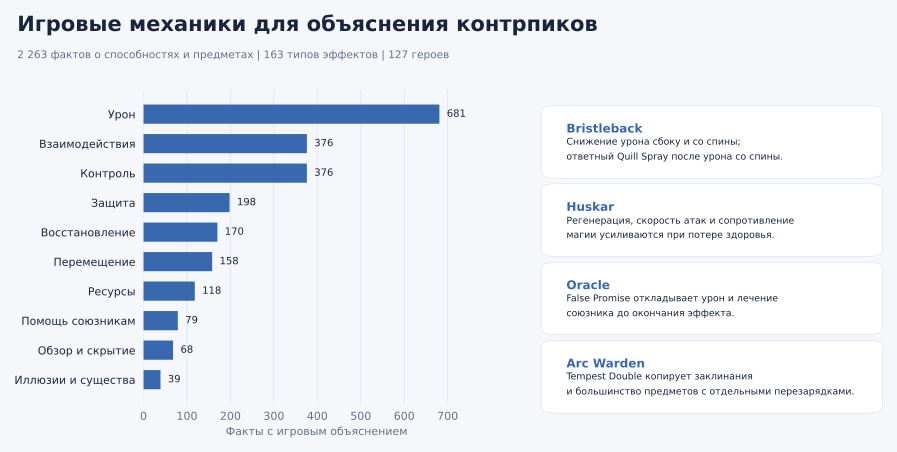
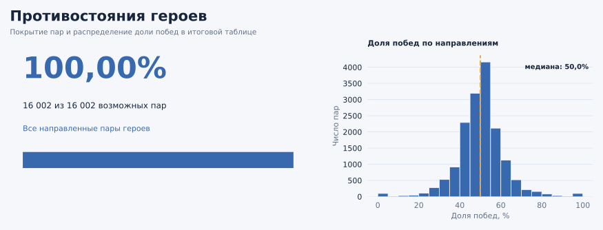
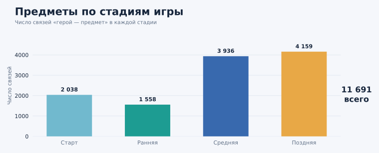
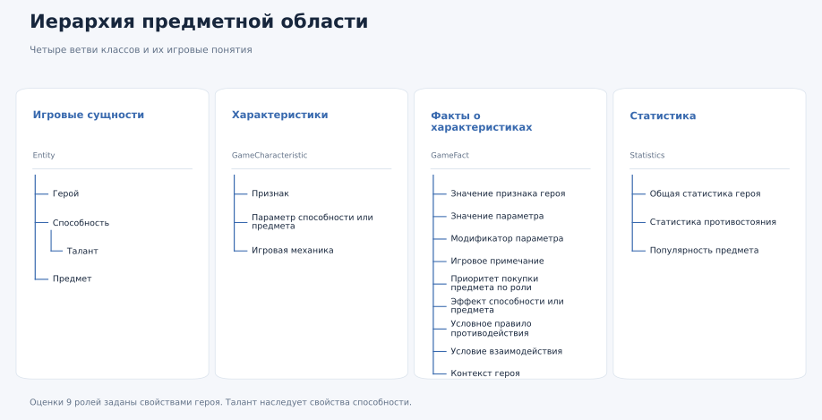
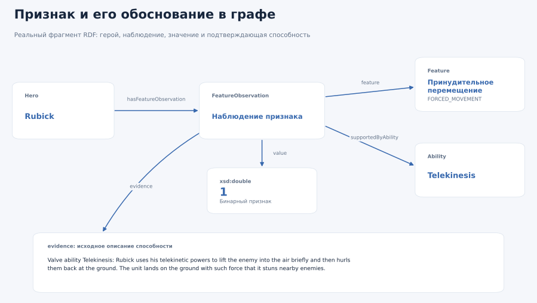

# Dota 2: граф знаний о контрпиках

Снимок игровых данных для графа знаний о контрпиках. Основные источники: [Valve](https://www.dota2.com/datafeed/herolist?language=english) и [OpenDota](https://api.opendota.com/api/heroes); ответы API получены **7 октября 2026 года**.


## Датасет

| Таблица | Объём | Содержание |
| --- | ---: | --- |
| [`heroes.parquet`](data/final/heroes.parquet) | **127** | Герои и их характеристики |
| [`abilities.parquet`](data/final/abilities.parquet) | **734** | Способности с привязкой к героям |
| [`items.parquet`](data/final/items.parquet) | **507** | Предметы и их свойства |
| [`hero_features.parquet`](data/final/hero_features.parquet) | **2 104** | Связи "герой - признак", **76** уникальных признаков |
| [`hero_feature_matrix.parquet`](data/final/hero_feature_matrix.parquet) | **127 x 76** | Значения признаков для каждого героя |
| [`matchups.parquet`](data/final/matchups.parquet) | **16 002** | Направленные противостояния героев |
| [`hero_items.parquet`](data/final/hero_items.parquet) | **11 691** | Связи "герой - предмет - стадия игры" |
| [`hero_meta.parquet`](data/final/hero_meta.parquet) | **127** | Общая статистика героев и показатели по рейтингам |
| [`hero_roles.parquet`](data/hero_roles.parquet) | **127** | Основная позиция каждого героя и дополнительная у 99 героев |
| [`mechanic_catalog.parquet`](data/mechanic_catalog.parquet) | **183** | Словарь механик эффектов и обобщений для правил |
| [`gameplay_mechanics.parquet`](data/gameplay_mechanics.parquet) | **2 263** | Факты о 673 способностях и 228 предметах; представлены все 127 героев |
| [`counter_rules.parquet`](data/counter_rules.parquet) | **106** | 80 правил для героев и 26 дополнительных правила для покупок |

## Признаки героев




**76 признаков** описывают героя в целом. **163 типа механик эффектов** уточняют действия конкретных способностей и предметов: получателя эффекта, условия применения и игровое объяснение. Число фактов отличается от числа типов: одна механика встречается у разных героев и предметов.



## Противостояния и предметы





## Онтология

[Игровая модель](ontology/game.ttl) | [Схема OWL](ontology/schema.ttl) | [Проверка](ontology/validation.json)

Значения признаков связаны с объяснениями и способностями, таланты - с модификаторами параметров. У героев хранятся оценки девяти игровых ролей и популярные позиции: `mostPopularPosition` и необязательное `secondMostPopularPosition`, целые числа от 1 до 5. У 28 героев с основной позицией 1 второе свойство отсутствует. В онтологии используется общая статистика; детализация по рейтингам сохранена в датасете.


| Структура | Количество |
| --- | ---: |
| RDF-тройки | **596 777** |
| Классы | **21** |
| Объектные свойства | **44** |
| Свойства данных | **119** |
| Значения признаков (герои x признаки) | **9 652** |
| Известные значения с объяснениями | **2 104** |
| Оценки ролей (свойства героев) | **1 143** |
| Популярные позиции (127 основных и 99 дополнительных) | **226** |
| Игровые параметры | **11 688** |
| Таланты героев | **1 016** |
| Связи модификаторов с талантами | **1 069** |
| Значения параметров | **21 956** |
| Модификаторы параметров | **1 365** |
| Пояснения механик и аспектов | **1 173** |
| Эффекты способностей и предметов | **2 868** |
| Механики эффектов и правил | **188** |
| Условные правила противодействия и компенсации | **119** |
| Условия взаимодействий | **590** |

Механики связаны со способностью или предметом через `hasEffect` и `effectMechanic`. Получатель хранится в `effectTarget`, игровые условия - в `requiresCondition`: например, наличие Shard/Scepter, ночь или нужная стойка. Условия улучшения относятся к соответствующему эффекту, а не ко всей способности. Из 119 правил 106 имеют веса: 80 общих правил и 26 дополнительных для покупок. Остальные сохраняют прежние взаимодействия и компенсацию уязвимостей.

`isObserved` отличает известное значение, включая ноль, от заполнителя матрицы. Урон, длительности эффектов, время поддержания и расход ресурсов связаны с именованными параметрами способностей и предметов. Отдельные эффекты и условия сохраняются раздельно; общие нулевые поля API не подменяют известные значения.






## Компетентностные вопросы

Компетентностные вопросы определяют задачи, которые должен решать граф знаний.

1. Какие герои могут противодействовать выбранному противнику благодаря своим способностям и игровым признакам?
2. Какие конкретные способности и механики объясняют преимущество одного героя против другого?
3. При каких условиях работает предложенное противодействие и какие ограничения оно имеет?
4. Какие способности и предметы позволяют прерывать поддерживаемые способности противника?
5. Какие герои и предметы позволяют противодействовать иллюзиям и призванным существам?
6. Какие способности и предметы позволяют обнаруживать невидимых противников?
7. Какие отрицательные эффекты противника можно снять и какие средства развеивания для этого необходимы?
8. Какие способности противника действуют сквозь невосприимчивость к эффектам?
9. Какие предметы подходят выбранному герою для противодействия конкретному противнику и почему?
10. Какие уязвимости выбранного героя можно компенсировать предметами?
11. Как наличие определённого предмета у противника влияет на эффективность контрпика?
12. Как таланты, аспекты, Aghanim’s Scepter и Aghanim’s Shard изменяют взаимодействие героев?

## Задать вопрос графу

```powershell
.\.venv\Scripts\python.exe -m dota_kg ask "кто контрит Фантом Лансера на миде"
.\.venv\Scripts\python.exe -m dota_kg ask "кто контрит ПЛ"
.\.venv\Scripts\python.exe -m dota_kg ask "что купить Rubick против ПЛ в поздней игре"
.\.venv\Scripts\python.exe -m dota_kg ask "почему Lion контрит Crystal Maiden" --format json
```

Текст разбирается в одну из 12 задач и только явно названные параметры. Для каждой
задачи есть один обработчик RDFLib; герои, способности, механики, предметы,
основания и условия ответа выбираются по графу. Есть [12 текстовых примеров](queries/examples.json) и четыре параметризуемых SPARQL-запроса: [01](queries/01_counterpicks.rq), [02](queries/02_explanations.rq), [03](queries/03_conditions.rq), [05](queries/05_illusions.rq).

Ранжирование учитывает силу контрмеханик, независимые способности и ответные угрозы противника. Повторы одной способности не умножают балл; статистика пары дает только небольшую поправку. Веса находятся в датасете и RDF, расчет общий для всех героев. Предметы и улучшения учитываются при явном указании их наличия. При выборе покупки дополнительно учитываются статистика сборок самого героя, его позиция и тип атаки, стадия покупки и уже имеющиеся механики; повторяющиеся решения не заполняют список. Это оценка общего противодействия, а не прогноз исхода линии.

Рекомендации используют основную и, при наличии, дополнительную позицию героя из графа: **1 - керри, 2 - мид, 3 - офлейн, 4 - поддержка, 5 - полная поддержка**. Герои с основной позицией 1 рекомендуются только на керри.
Без указания позиции возвращаются варианты для каждой из пяти позиций, с позицией - только для нее.
Поддерживаются английские имена и распространённые русские клички: ПЛ, фантомка,
ЦМ, АМ, рубик и другие. Разбор пока основан на ключевых формулировках, поэтому
не гарантирует понимания произвольного текста. Отсутствующие знания не выдумываются. Для описаний используется официальная русская локализация Valve;
при отсутствии подходящего перевода сохраняется исходный текст. Наши собственные фразы переведены на русский;
игровые названия героев, способностей и предметов сохраняются. Результаты SPARQL
показываются отдельными текстовыми блоками с переносами строк.

[Устройство поиска и ограничения покрытия](queries/README.md) ·
[Фактические ответы](data/reports/competency-answers.md)

Проверить все вопросы и тесты:

```powershell
.\.venv\Scripts\python.exe scripts/check_competency_queries.py
.\.venv\Scripts\python.exe -m unittest discover -s tests
```
