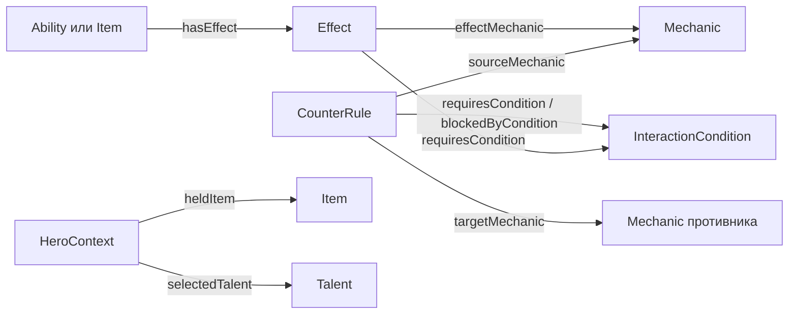

# Эффекты и условные взаимодействия

Расширение добавляет модель объяснимого подбора кандидатов. Оно не вычисляет
вероятность победы и не утверждает, что наличие механики гарантирует контрпик.
Аспекты остаются в исходных данных; расширение их не использует.



## Откуда берутся утверждения

`dota_kg/ontology_interactions.py` вызывается при обычном экспорте онтологии.
Эффекты входят в `data-entities.ttl`; дополнительные импорты не нужны.

- `feature-derived`: положительное наблюдаемое значение признака, для которого
  уже есть `supportedByAbility`. `derivedFromFeatureValue` сохраняет основание.
  Агрегаты, неподтверждённые нули и признаки без конкретной способности не
  превращаются в эффекты. Сохранена существующая неполнота извлечения признаков:
  это кандидаты механик, а не полная разметка всех составляющих способности.
- `curated-description`: небольшой явный список предметов и проверяемых фраз
  их описаний. Поиск слов по всему каталогу не используется. Изменение ожидаемой
  фразы останавливает экспорт и требует пересмотреть разметку.
- `structured-description`: развеивание предмета из существующего `dispelType`.
  Оно ещё не определяет, на кого можно применить развеивание.

У каждого эффекта есть `evidence` и `effectStatus`. Способности, предоставляемые
Scepter или Shard, имеют условие `has-item` со стороной `source`.
Для улучшений существующих способностей по-прежнему доступны
`hasScepterValue`, `hasShardValue`, описания и модификаторы параметров.
Их наличие не делает все улучшенные эффекты доступными без предмета.

## Правила и условия

Набор из 19 правил связывает контроль с применением способности, обнаружение с
невидимостью, урон по области с иллюзиями/существами, снижение лечения с лечением,
точность с уклонением и обездвиживание с мобильностью. Правило ARMOR_BUFF → LOW_ARMOR
имеет `rulePurpose=compensate` и применяется только к уязвимости собственного
героя; остальные правила имеют `rulePurpose=counter`.

Все правила имеют `ruleStatus = "heuristic"`, основание и обязательную оговорку
`requiresCondition`. Их нельзя представлять как доказанное преимущество.
`blockedByCondition` отмечает проверку невосприимчивости для контроля; это повод
проверить конкретный эффект, а не безусловный запрет для всех проходящих эффектов.

Условия имеют `conditionScope` (`source` или `target`) и `conditionKind`:

| Вид | Значение |
| --- | --- |
| `review` | Текстовое условие, требующее проверки; автоматически истинным не считается |
| `has-item` | Наличие конкретного `conditionItem` |
| `has-mechanic` | Наличие конкретной `conditionMechanic` |
| `has-talent` | Выбор конкретного `conditionTalent` |

SHACL проверяет допустимые значения и наличие объекта у структурированных условий.
Полная валидация также сравнивает эффекты, основания, правила и условия с заново
построенным расширением; потерянные или произвольно добавленные факты отклоняются.

`requiredDispel` заполнен для проверенных эффектов Earth Spike, Hex, Orchid и
Bloodthorn по кодам `dispellableCode`: **1 — Strong, 2 — Basic, 3 — None**.
Соответствие сверено с [официальным кодом тултипов Valve](https://www.dota2.com/public/javascript/dota_react/main.js).
Код 0 не содержит классификации. Код не копируется на несвязанные механики,
например на мгновенный урон. `dispelTarget` различает развеивание на себе и
союзнике: Manta снимает безмолвие с владельца, Aphotic Shield снимает оглушение
с союзника сильным развеиванием. Manta не предлагается для снятия оглушения.

Для **BKB** действует заданное пользователем правило: нет явного
`piercesDebuffImmunity = true` — прохода нет. Запросы возвращают булево значение,
не вариант «не знаю». Это правило не переносится на неизвестные значения других признаков.

## Пригодность предмета по роли

`ItemRolePreference` связывает предмет с ролью (`carry`, `support`, `core`),
стадией покупки (`purchasePhase`) и приоритетом 1–3 (`preferenceRank`).
Это авторские рекомендации, а не запрет покупать предмет другими героями.
Scythe остаётся доступным любому герою; его высокий приоритет для поддержки
не делает его универсальным ответом для керри.

В примерах роль по умолчанию определяется из `carryLevel` и `supportLevel`;
её можно явно задать в запросе для фактической позиции игрока. У Battle Fury
дополнительно требуется `Melee`: его cleave не предлагается дальнему керри.
Для Mjollnir выделен эффект ответных молний: требуется наложить Static Charge
на атакуемую цель; вероятность срабатывания не превращается в гарантированное
мгновенное уничтожение всех иллюзий. Battle Fury обрабатывает группу иллюзий
уроном от атак, Scythe уничтожает одну иллюзию и контролирует настоящего героя.

## Контекст предметов и талантов

`HeroContext` — входные данные сценария, а не сведения из статистики популярности.
Начальный экспорт не выдумывает экипировку участников и не создаёт контексты.
Их можно добавить в рабочую копию графа перед выполнением запроса:

```turtle
@prefix kg: <https://github.com/vladlenblch/dota2-counterpick-knowledge-graph/ontology#> .
@prefix hero: <https://github.com/vladlenblch/dota2-counterpick-knowledge-graph/resource/hero/> .
@prefix item: <https://github.com/vladlenblch/dota2-counterpick-knowledge-graph/resource/item/> .
@prefix context: <https://github.com/vladlenblch/dota2-counterpick-knowledge-graph/resource/context/> .

context:example a kg:HeroContext ;
    kg:hero hero:86 ;
    kg:heldItem item:116 ;
    kg:contextComplete false .
```

`contextComplete = false` означает, что список частичный. Даже при полном списке
нельзя считать отсутствующую игровую механику ложной: полнота относится только
к введённым предметам и талантам. Контекст не хранится в каноническом экспорте,
сверяемом с датасетом; его проверяют отдельно через SHACL.

## Что меняется для компетентностных вопросов

| Вопросы | Возможность после расширения |
| --- | --- |
| 1–2 | Находить кандидатов по цепочке эффект → механика → правило → механика противника, возвращая основания и статус |
| 3 | Возвращать условия и ограничения, различая структурированные требования и ручную проверку |
| 4–6 | Выбирать кандидатов для прерывания, борьбы с иллюзиями/существами и обнаружения; покрытие разметки ограничено |
| 7 | Для проверенных эффектов выбирать обычное/сильное развеивание с учётом цели применения |
| 8 | Явный проход сквозь BKB даёт true, отсутствие явного прохода — false |
| 9–10 | Подбирать и приоритизировать предметы по механике, роли, стадии и типу атаки; компенсация остальных характеристик требует дополнительных правил |
| 11 | По заданному контексту находить предметы, требующие пересмотра применимости правила; числовой поправки к преимуществу нет |
| 12 | Учитывать предметы для предоставляемых способностей, читать существующие значения улучшений и связи талантов; изменения механик требуют дальнейшей разметки |

Полное содержательное покрытие всех вопросов требует расширять разметку эффектов
и проверенные правила. Одно лишь добавление классов не восстанавливает отсутствующие
знания. За исключением принятого правила BKB, неподдержанный случай возвращается как неизвестный, а не как
отрицательное утверждение или гарантированная рекомендация.

## Запуск

В PowerShell после создания `.venv` и установки `requirements.txt`:

```powershell
.\.venv\Scripts\python.exe -m dota_kg ontology
.\.venv\Scripts\python.exe -m unittest discover -s tests
```

Команда экспорта пересобирает RDF, SHACL и отчёт проверки. Сбор данных из сети
для этого не требуется.

## Текстовые вопросы

Команда `python -m dota_kg ask "кто контрит ПЛ на миде"` разбирает вопрос и вызывает
один из 12 обработчиков RDFLib. Они обходят граф, находят фактические механики,
правила, условия и основания. Прежние 60 подготовленных запросов удалены.
Согласованное соответствие ролей: Carry — керри/мид, Nuker — тройка, Support — 4/5.
Имена и прозвища используются только для распознавания сущностей.
Подробности и ограничения — в [описании поиска](../queries/README.md).
